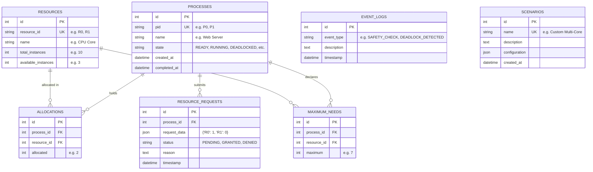

# Database Schema & Application Data Flow

This document details the persistence layer, database models, foreign key relationships, and complete lifecycle of data transformations in the **Deadlock-Safe Task Manager**.

---

## 1. Persistence Layer: SQLite & SQLAlchemy

The application persists all simulation data in a local SQLite relational database located at:
```
instance/database.db
```

SQLAlchemy ORM (`database/database.py` and `database/models.py`) manages table schemas, connections, and ACID transactions.

---

## 2. Relational Database Schema



---

## 3. The 7 Data Models Detailed

### 1. `Process` (`processes`)
- Represents a simulated process thread.
- **Key Fields**: `pid` (Unique, indexed), `name`, `state` (Defaults to `READY`), `created_at`, `completed_at`.
- **Relationships**: One-to-many with `Allocation`, `MaximumNeed`, and `ResourceRequest` (with cascade delete).

### 2. `Resource` (`resources`)
- Represents a discrete, multi-instance resource type.
- **Key Fields**: `resource_id` (Unique, e.g., `R0`), `name` (`CPU Core`), `total_instances`, `available_instances`.
- **Computed Property**: `utilization_percent` = $(\text{Allocated} / \text{Total}) \times 100$.

### 3. `Allocation` (`allocations`)
- Represents the number of units of resource $R_j$ currently held by process $P_i$.
- **Constraints**: Unique constraint on `(process_id, resource_id)`.

### 4. `MaximumNeed` (`maximum_needs`)
- Stores the maximum demand declared by process $P_i$ for resource $R_j$.
- **Constraints**: Unique constraint on `(process_id, resource_id)`.

### 5. `ResourceRequest` (`resource_requests`)
- Tracks dynamic resource requests submitted by processes.
- **Key Fields**: `process_id`, `request_data` (JSON dictionary mapping resource IDs to requested units), `status` (`PENDING`, `GRANTED`, `DENIED`), `reason`, `timestamp`.

### 6. `EventLog` (`event_logs`)
- Stores an immutable audit trail of simulation actions for academic inspection and viva demonstrations.
- **Event Types**: `PROCESS_CREATED`, `RESOURCE_CREATED`, `REQUEST_GRANTED`, `REQUEST_DENIED`, `SAFETY_CHECK`, `DEADLOCK_DETECTION`, `DEADLOCK_RECOVERY`, `SCENARIO_LOADED`, `SIMULATION_RESET`.

### 7. `Scenario` (`scenarios`)
- Stores user-defined custom scenario configurations in JSON format for quick reloading.

---

## 4. End-to-End Execution Data Lifecycle

```
[1] User interacts with UI (e.g. clicks "Submit Request" on /resource-request)
                               │
                               ▼
[2] Vanilla JS issues asynchronous fetch (POST /api/resource-request)
                               │
                               ▼
[3] Flask Blueprint routes call to Simulation Coordinator (simulation/simulator.py)
                               │
                               ▼
[4] Simulator extracts current state from SQLite into in-memory dictionaries:
    Available = {R0: 3, R1: 3, R2: 2}
    Allocation = {P0: {...}, P1: {...}}
    Maximum = {P0: {...}, P1: {...}}
    Need = Maximum - Allocation
                               │
                               ▼
[5] Algorithm Engine executes pure mathematical evaluation (algorithms/resource_request.py)
    - Checks Request <= Need
    - Checks Request <= Available
    - Clones tentative state
    - Executes Dijkstra's Safety Algorithm
                               │
                               ▼
[6] Database Transaction (ACID Commit or Rollback):
    - If SAFE:
        Allocation[P1][R0] += 1
        Resource[R0].available -= 1
        Process[P1].state = 'RUNNING'
        ResourceRequest.status = 'GRANTED'
        EventLog.record('REQUEST_GRANTED')
        db.session.commit()
    - If UNSAFE:
        db.session.rollback()
        Process[P1].state = 'WAITING'
        ResourceRequest.status = 'DENIED'
        EventLog.record('REQUEST_DENIED')
        db.session.commit()
                               │
                               ▼
[7] Flask serializes response to JSON (granted, reason, trace, new matrices)
                               │
                               ▼
[8] Client Browser receives JSON:
    - Renders 5-step stepper visually
    - Updates status badges
    - Redraws Cytoscape graphs and Chart.js charts
```
