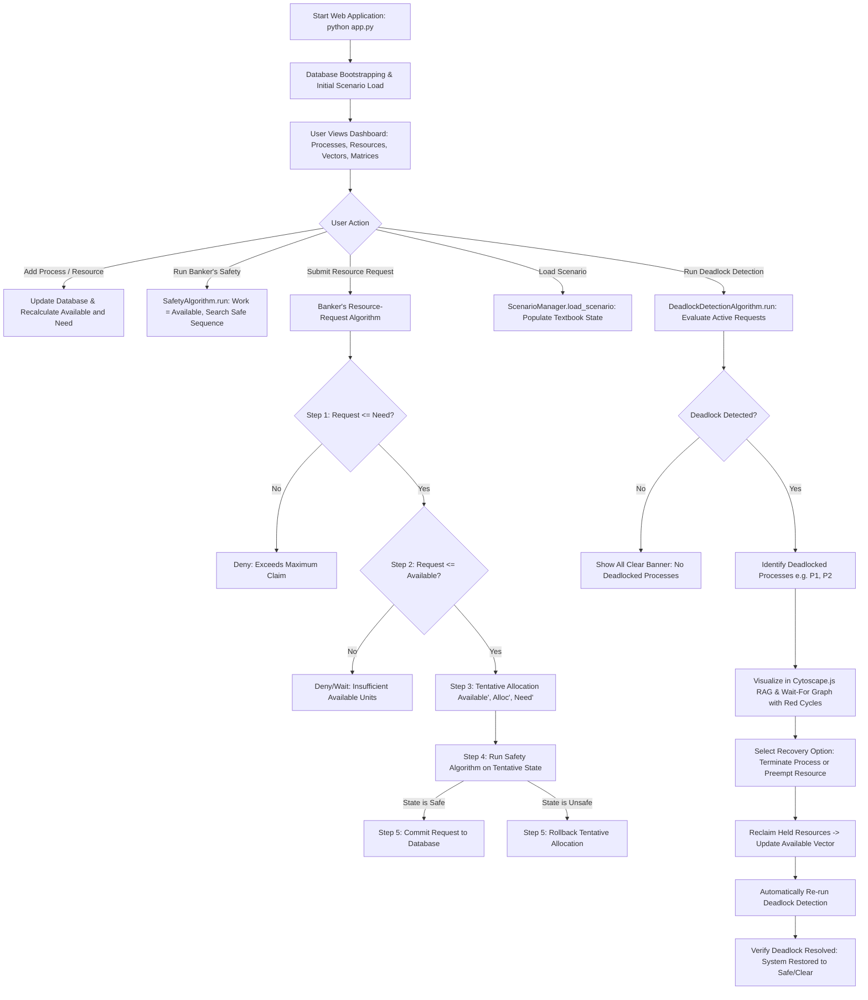

# Complete Project Lifecycle & Execution Flow

This document details the step-by-step end-to-end flow of the **Deadlock-Safe Task Manager**, from the moment the web application boots to the point where deadlocks are introduced, detected, visualized, and resolved.

---

## 1. High-Level Flowchart

---

## 2. Step-by-Step Walkthrough

### Step 1: Application Bootstrapping
1. The user runs `python app.py`.
2. Flask initializes extensions, registers all blueprints (`api_bp`, `dashboard_bp`, `processes_bp`, etc.), and creates the SQLite tables in `instance/database.db`.
3. If the database is empty on first boot, `ScenarioManager.load_scenario('safe_state')` is executed automatically.
4. The system is populated with the classic textbook safe state: 5 processes ($P_0$–$P_4$) and 3 resource types ($R_0, R_1, R_2$).

### Step 2: Defining Processes and Maximum Demand
1. Processes are represented by records in the `processes` table.
2. For each process, an initial **Maximum Demand vector** is declared for every resource type ($Maximum[i][j]$).
3. The Maximum Demand represents the total instances process $P_i$ will ever need during its entire execution.

### Step 3: Initial Resource Allocation
1. The system records currently held resources in the `allocations` table ($Allocation[i][j]$).
2. The simulation engine validates that for every process $i$ and resource $j$:
   $$Allocation[i][j] \le Maximum[i][j]$$
   $$\sum_{i=0}^{n-1} Allocation[i][j] \le Total[j]$$

### Step 4: Need Vector Calculation
1. The **Need Matrix** is **never** entered manually or stored independently.
2. It is calculated dynamically whenever queried:
   $$Need[i][j] = Maximum[i][j] - Allocation[i][j]$$
3. This guarantees that $Need$ is always synchronized with $Maximum$ and $Allocation$.

### Step 5: Available Vector Calculation
1. The system pool of free resources is computed as:
   $$Available[j] = Total[j] - \sum_{i=0}^{n-1} Allocation[i][j]$$
2. The simulation prohibits any allocation that would cause $Available[j] < 0$.

### Step 6: User Submits a Dynamic Resource Request
1. On the **Resource Request** page (`/resource-request`), the user selects process $P_i$ and enters a request vector (e.g., $P_1$ requests $R_0=1, R_1=0, R_2=2$).
2. Clicking **Evaluate & Allocate Request** sends a `POST /api/resource-request` to the backend.

### Step 7: Executing the Banker's Resource-Request Algorithm
The backend algorithm (`algorithms/resource_request.py`) executes 5 formal steps:
- **Step 1 ($Request \le Need$)**: Verifies that process $P_i$ has not asked for more resources than its remaining claim. If violated, the request is denied immediately with error: *"Process has exceeded its maximum claim."*
- **Step 2 ($Request \le Available$)**: Checks whether the system currently has enough free instances to satisfy the request right now. If not, the request is denied with reason: *"Insufficient available resources. Process must wait."*
- **Step 3 (Tentative Allocation)**: The simulation creates a tentative in-memory clone of the system state:
  $$Available' = Available - Request$$
  $$Allocation[i]' = Allocation[i] + Request$$
  $$Need[i]' = Need[i] - Request$$
- **Step 4 (Safety Test)**: The `SafetyAlgorithm` is executed on this tentative state. It looks for a sequence where every process can satisfy its remaining need and finish.
- **Step 5 (Decision & Commit/Rollback)**:
  - **If Safe**: The tentative allocation is **committed** to the database, $Available$ is decremented, the process state transitions to `RUNNING`, and an audit event `REQUEST_GRANTED` is logged.
  - **If Unsafe**: The tentative state is **discarded (rolled back)**, the real database remains unchanged, the process enters `WAITING`, and an audit event `REQUEST_DENIED` is logged.

### Step 8: Execution of Deadlock Detection
1. When processes hold resources and are simultaneously waiting for resources held by other processes, a circular wait may form.
2. The user navigates to **Deadlock Detection** (`/deadlock-detection`) or loads a scenario such as *Two-Process Circular Deadlock*.
3. Clicking **RUN DEADLOCK DETECTION** invokes `algorithms/deadlock_detection.py`.
4. The algorithm:
   - Sets $Work = Available$.
   - Sets $Finish[i] = true$ for processes with zero allocation, and $false$ for processes holding allocations.
   - Searches for any process where $Finish[i] == false$ and $Request[i] \le Work$.
   - If found, it marks $Finish[i] = true$, reclaims its allocation into $Work$, and repeats.
   - Any process remaining with $Finish[i] == false$ is officially **DEADLOCKED**.

### Step 9: Visualizing via RAG and WFG
1. The user navigates to **Graphs** (`/graphs`).
2. Cytoscape.js renders:
   - **Resource Allocation Graph (RAG)**: Circles for processes, rounded rectangles for resources, solid blue arrows for allocations ($R_j \to P_i$), and dashed yellow arrows for requests ($P_i \to R_j$).
   - **Wait-For Graph (WFG)**: Nodes collapsed to processes only. Directed edge $P_i \to P_j$ shows that $P_i$ is waiting for a resource currently held by $P_j$.
   - **Cycle Highlighting**: Depth-first search (DFS) detects cycles (e.g., $P_1 \to P_2 \to P_1$) and colors the nodes and edges in bold red.

### Step 10: Deadlock Recovery
1. The **Deadlock Recovery Panel** appears on the detection screen.
2. The user has two options:
   - **Process Termination**: Selects victim process $P_1$ and clicks **Terminate Victim**. The system sets $P_1$'s state to `TERMINATED`, immediately returns all its held resources back to the $Available$ pool, and clears its pending requests.
   - **Simulated Resource Preemption**: Simulates seizing a resource unit from a holding process and transferring it to a waiting process.
3. The system automatically re-executes the Deadlock Detection algorithm on the updated state.
4. The screen updates with: **NO DEADLOCK DETECTED! Deadlock Resolved.**

### Step 11: Resetting the Simulation
1. The user clicks **Reset** in the top navigation bar at any time.
2. The backend reloads the default `safe_state` scenario, resetting all processes, resources, allocations, and requests back to a known baseline.
